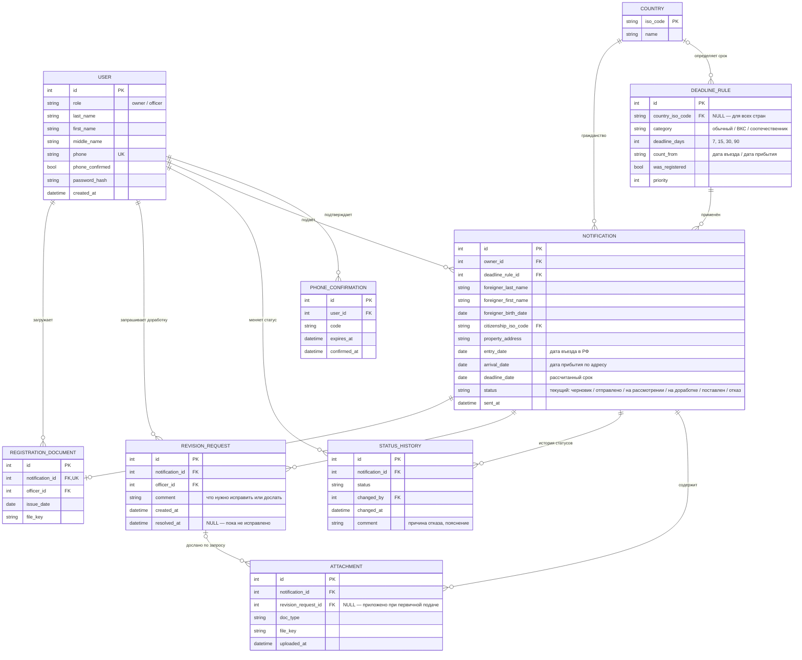

## Пояснения

Модель описывает данные портала миграционного учёта: пользователей, уведомления о постановке иностранного гражданина на учёт, их рассмотрение сотрудником УМВД и результат.

### Сущности

- **USER** — пользователь портала. Поле `role` различает собственника помещения (`owner`), который подаёт уведомления, и сотрудника УМВД (`officer`), который их рассматривает. Вход выполняется по уникальному номеру телефона.
- **PHONE_CONFIRMATION** — SMS-код подтверждения телефона при регистрации и входе, со сроком действия и отметкой об использовании.
- **COUNTRY** — справочник стран (код ISO и название), используется для гражданства иностранца и для правил расчёта сроков.
- **DEADLINE_RULE** — правило расчёта срока постановки на учёт: категория иностранца (обычный, ВКС, соотечественник), число дней, точка отсчёта (дата въезда или дата прибытия) и признак того, состоял ли иностранец на учёте ранее. Если страна не указана, правило применяется ко всем остальным странам; при совпадении нескольких правил выбирается правило с наибольшим приоритетом.
- **NOTIFICATION** — уведомление о постановке иностранца на учёт: данные иностранца, адрес помещения, даты въезда и прибытия, рассчитанный срок и текущий статус. Список уведомлений пользователя — это история ранее запрошенных услуг.
- **STATUS_HISTORY** — журнал изменений статуса уведомления: какой статус установлен, кем и когда, с комментарием (например, причиной отказа). По нему пользователь просматривает историю статусов. Поле `NOTIFICATION.status` хранит последний статус для быстрого поиска.
- **REVISION_REQUEST** — запрос сотрудника на доработку уведомления: что нужно исправить или дослать. Когда пользователь отправляет доработанное уведомление, запрос закрывается (`resolved_at`).
- **ATTACHMENT** — копии документов, приложенные к уведомлению. Если документ дослан по запросу на доработку, он ссылается на этот запрос.
- **REGISTRATION_DOCUMENT** — документ о постановке на учёт, который сотрудник загружает при положительном решении. У уведомления может быть не больше одного такого документа.

### Связи

- Пользователь подтверждает телефон, подаёт уведомления, а сотрудник меняет их статусы, запрашивает доработку и загружает документы о постановке на учёт.
- Срок в уведомлении рассчитывается по правилу, которое выбирается по гражданству иностранца.
- Каждое изменение статуса уведомления порождает запись в истории статусов.
- Уведомление может несколько раз возвращаться на доработку; документы, досланные в ответ, связаны с конкретным запросом.
